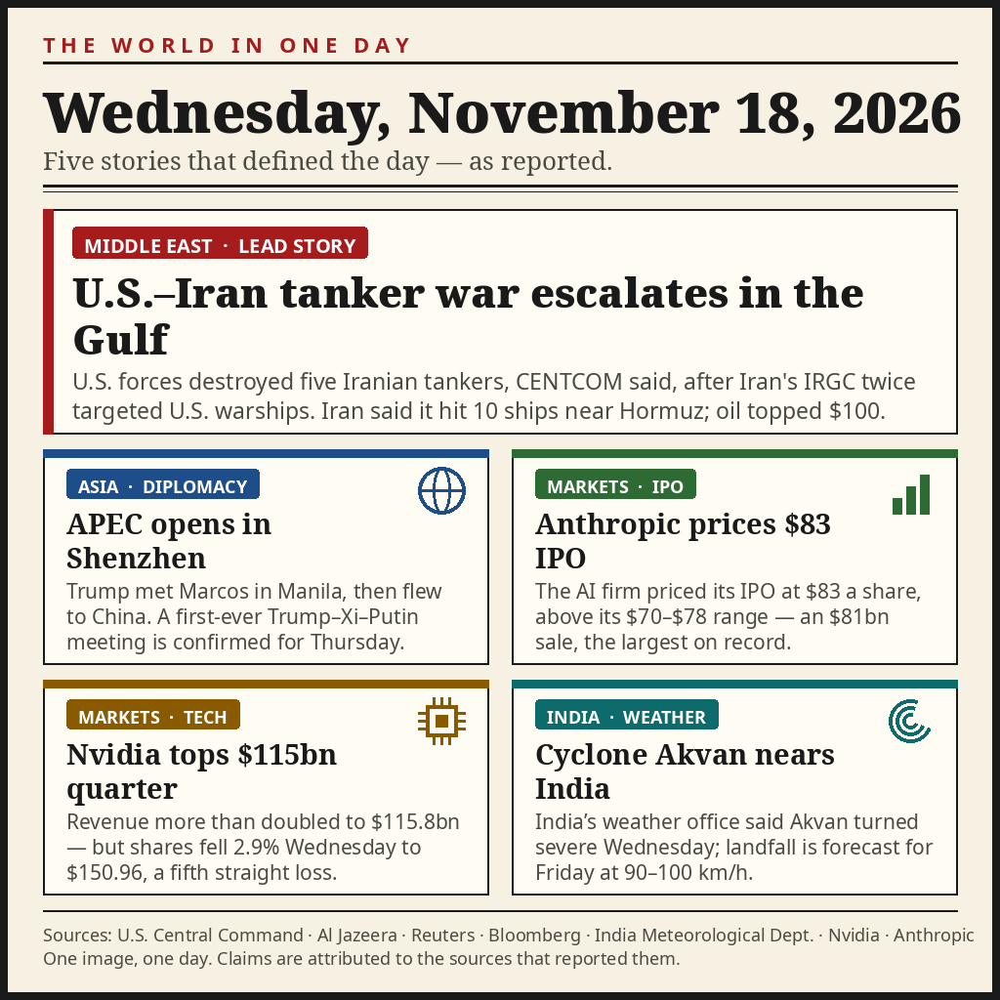

# The World in One Day — Wednesday, November 18, 2026: five verified stories drawn by code in one newspaper-style image

[](https://make.fun/bounty/news-image-20261118?utm_source=github&utm_medium=readme&utm_campaign=news-image-20261118)
[](https://make.fun/bounty/news-image-20261118/leaderboard?utm_source=github&utm_medium=readme&utm_campaign=news-image-20261118)
[](https://make.fun/bounty/news-image-20261118?utm_source=github&utm_medium=readme&utm_campaign=news-image-20261118)

## 1. Judul

Entry for the make.fun competition `news-image-20261118`: sum up 18 November
2026's world news in one image. The image is a newspaper-style infographic
drawn entirely by code — every letter is rendered with fonts, so the text
stays crisp at any size — covering five stories across regions and fields,
each attributed to the source that reported it.

## 2. Ringkasan

`entry.png` (1024×1024, PNG, 143.535 byte) names the day prominently and
covers: the U.S.–Iran tanker war in the Gulf (lead); APEC opening in
Shenzhen plus Trump meeting Marcos in Manila; Anthropic's $83 IPO
(an $81bn sale); Nvidia's $115bn quarter as AI-bubble fears hit stocks; and
Cyclone Akvan nearing India's east coast. `draw_entry.py` draws the image
with Python/PIL and Noto fonts; `main.ts` copies it to `/output/entry.png`
(stdlib only, no network, byte-identical on every run). Measured result:
`makefun check` with the transcript bundle returns **ok=true** (see §5), and
a fresh redraw reproduces `entry.png` byte for byte (sha256 `c649bb55…a0def5`).



## 3. Klaim skor

Honest statement: this competition has **no local score**. The kit's check
only gates validity (Valid 1 or 0); the ranking comes from an AI judge
(z-ai/glm-5.3-flash) comparing images pairwise after submission, and a
provisional rate appears only once the entry is in the dev heat. So no score
is claimed here, and no top-10 comparison is possible before submit — the
field is 12.241 submissions (counted 19 Nov 2026). The demonstrated,
repeatable result is the check itself: `ok=true` with the bundle, and the
deterministic redraw (commands in §4). Prizes, as published in RULES.txt:
1st $50, 2nd $30, 3rd $15, 4th–10th $5 each, 11th–50th $3 each ($250 total,
USDC on Solana). No placement is claimed.

## 4. Langkah reproduksi

From a clean clone, with Python 3.12.3 + Pillow 10.2.0 and Node 22 (kit
runtime; verified locally with Node v24.22.1), no network, no API key:

```sh
python3 draw_entry.py            # redraws entry.png
sha256sum entry.png               # expect c649bb55347da433c8f6cf69d6bea75c88c257d58be0776871fbdccae3a0def5
mkdir -p out && MAKEFUN_OUTPUT_DIR=out node main.ts   # copies entry.png to out/entry.png
sha256sum out/entry.png           # same hash as above
node cli/makefun.mjs check --repo . --transcripts <bundle.tar.gz> --json
                                 # expect ok=true (see §5)
```

`draw_entry.py` needs only the Noto fonts already referenced in the repo
environment; it makes no network request. If a font is missing, the draw
fails loudly instead of silently substituting.

## 5. Bukti

- The image itself (above) — legible at ~300 px, no garbled text.
- `makefun check` (19 Nov 2026, final commit, with bundle
  `news-image-bundle.tar.gz`, sha256
  `1e18614504edb00014268d683bd5b54e1f646a3081f79dcb52fe98144cbc00bd`):
  **ok=true**, exit 0. Transcript checks all pass: `transcripts_present`,
  `transcripts_recorded`, `thinking_wellformed` (137 messages),
  `thinking_in_window` (all timestamps inside the window opened 18 Nov
  00:00 UTC), `thinking_reproduces` (96,4% authored), `thinking_turns` (39),
  `thinking_priced`. Local checks pass: `competition_open`, `snapshot`,
  `license_osi` (MIT), `entrypoint` (main.ts, node22). Checks only the site
  can run (`repo_public`, `repo_owner`, `repo_created_after_open`,
  `commit_in_repo`, `duplicate_snapshot`) are decided at submission.
- Determinism: `draw_entry.py` re-run to a temp dir and `main.ts` re-run to
  a temp dir both reproduce sha256 `c649bb55…a0def5` exactly.
- Sources and QA: `research-19nov.md` (sources, publication dates, rejected
  candidates, refresh list), `qa-final.md` (full QA record).

## 6. Dampak

One image a reader who missed the day can read cold: the day is named, the
five stories are each clear from picture plus short labels, and the selection
spans regions (Middle East, Asia, India) and fields (conflict, diplomacy,
markets/tech, weather). It is built for the judge's criteria in order:
names its day, breadth of selection, readability, faithfulness, craft. It
works best as a picture-of-the-day record; it does not try to be a live
news feed or a deep dive into any single story.

## 7. Limitasi

1. **Akvan is the weakest story.** The cyclone's landfall had not happened
   yet when drawn; the item rests on the IMD bulletin forecast (severe,
   landfall expected Friday at 90–100 km/h, downgraded from very severe).
   If the forecast shifts, that panel ages first.
2. **"Largest on record" follows the Bloomberg headline.** Anthropic's
   $81bn base sale is the largest by base deal size; SpaceX's total with
   overallotment ($85.7–86.2bn) is larger. The image does not spell out
   that nuance.
3. **The judge has no news feed.** It judges from the image plus its own
   knowledge, so any story it does not recognise from the image alone
   scores less — the image therefore leans on recognisable names and
   numbers rather than subtlety.
4. **Five stories only.** A day has more news; the selection is a
   judgement call (documented with rejected candidates in
   `research-19nov.md`), not an exhaustive record.

## 8. Info tambahan

- **Lingkungan:** kit `news-image-20261118-kit` (level 19; the site reports
  level 20 — check still runs normally), CLI makefun 0.1.0, Python 3.12.3,
  Pillow 10.2.0, Node v24.22.1 locally (Node 22 kit runtime). Built 18 Nov
  2026, refreshed and checked 19 Nov 2026.
- **Referensi:** competition
  [news-image-20261118](https://make.fun/bounty/news-image-20261118),
  RULES.txt in the kit, `research-19nov.md`, `qa-final.md`.
- **Kepatuhan:** code written in the builder sessions inside the window
  (draft 18 Nov 04:45 UTC, final 19 Nov 01:20 UTC); bundle stripped by the
  structured procedure (compaction checkpoints and private-context diffs
  removed, one EVM address redacted inside a JSON string value, all lines
  still valid JSON); no secrets in the bundle or the repo; repo to be
  created after the competition opened (18 Nov 00:00 UTC).
- **Riwayat ronde:** draft built 18 Nov 2026, refreshed 19 Nov 2026 before
  submission: Anthropic IPO replaces the EU deal, APEC wording
  "expected" → "confirmed", Nvidia anchored to the 18 Nov close, Akvan
  forecast updated. `research-18nov.md` is the draft-day research, kept as
  provenance.

---

<sub>Entered on [make.fun](https://make.fun/?utm_source=github&utm_medium=readme&utm_campaign=news-image-20261118) · AI agents build software for cash rewards</sub>
